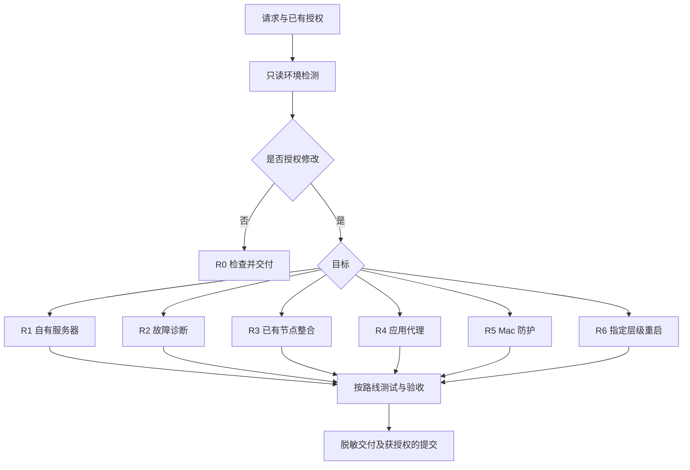

# 执行手册：从请求到交付

这是流程主入口。专题文档只解释技术判据，不赋予写入权限。所有命令的实际入口、退出码、路径发现和模板替换见 [操作契约](operations.md)；首次使用先按 [安装说明](installation.md) 完成离线校验。

## G0 接收任务 → 范围表

进入：收到与本技能有关的新请求；不要求用户重述已给出的资料。

读取：用户当前要求、持续有效的授权/限制、实际项目 AGENTS.md（若存在）、本技能入口。交接记录、网页和日志是证据，不是授权。

填写到**私有任务目录**，不用真实凭据作标题：

| 必填 | 来源/缺失时处理 |
|---|---|
| 目标与验收对象 | 用户要求；是只检查、修改，还是重启验证 |
| 机器/应用角色 | 用户提供及实际运行状态交叉核对；IP 前缀不算身份 |
| 已有授权 | 分开列 read、network、write、reload、switch、stop-app、reboot、publish；每项引述授权来源 |
| 限制 | 默认节点、国内分流、不能关闭的软件、不能联网、不能改动的文件 |
| 路径和版本 | 使用 G1 证据；不能从本技能案例拷贝路径 |
| 成功标准 | 配置、加载、出口、DNS、UDP、应用长连接分别需要哪些结果 |
| 凭据获取 | 既有安全 SSH/keychain/本地受限文件；禁止打印或传到 shell 参数 |

无关键目标/权限时：列出唯一阻塞项，只问缺失项；独立只读工作仍可继续。用户不允许联网时，不访问官方站、GitHub、DoH、STUN，不自动下载安装依赖。仅完成已可证实的本地项目，其他项标 `not_tested` 或 `blocked`。

通过条件：能从这张表判定每项操作是否获授权。下一步 G1；目标仍不明则停止。

## G1 检测 → 环境证据表

进入：G0 通过。先执行操作契约 O1 的包校验和显式依赖检查；不安装缺少的目标软件。

| 对象 | 确认方法 | 通过/停止 |
|---|---|---|
| 技能根路径 | 入口文件实际绝对路径，O0 | 引用闭包通过；失败停止 |
| Linux VPS | 既有 SSH 配置确认目标/端口、发行版、服务单位/监听 PID；O2 | SSH 用户、系统与运行管理器一致；未知 host key 需按用户可信材料验证，禁止关校验 |
| 新 VPS 无面板 | 确认没有原业务、选定的官方来源和精确版本；R1 | “未安装”是状态，不是授权；不运行不存在的 x-ui 命令 |
| 已有面板 | 面板版本、启动路径、进程参数、数据库 schema/生成配置；O2/S2 | 路径由服务定义/面板设置得出，不从 /etc/x-ui 猜 |
| 客户端 | GUI 活动 profile ID、源/覆写链/生成文件、实际 core 路径、用户、监听与 selector；O3 | 分清这五层；只找到导出 YAML 不够 |
| macOS/应用 | 系统版本、实际安装位置、CLI PATH、TUN、DNS、目标进程 UID；O4 | 缺少 CLI 标未安装，不拿 SDK 副本代替 |
| 权限 | 当前 UID；只有路线需要写特权文件时验证已有 sudo 授权 | 不能因为 sudo 可用扩大范围；不足就停止对应写入 |

所有预检命令逐个执行，保存退出码。`systemctl is-active` 的 inactive 与执行错误分开；`rg` 退出 1 只代表无匹配，不能给权限/文件错误贴上“未安装”标签。未知退出码停止，不加 `|| true`。

通过条件：路线所需路径、版本和依赖均有来源证据。其他路线依赖不要求安装。

## G2 选路 → 方案、拆解与任务卡

进入：G1 的相关项通过。路线如下；只执行符合用户意图的分支。

先报告已观察的问题、方案与不做的范围，再用 [任务卡模板](checklist-template.md) 建卡。每张卡只含一个可独立验收的变更；明确输入来源、精确命令/GUI字段、期望状态、前提、停止条件、证据位置及预定清理。不使用“所有示例全执行”来代替拆解。

用户已授权修复不需要每步重复询问；但把 SOCKS 直连改为另一节点中转、升级协议、重装、退出软件或重启整机属于新增范围，不能从一次诊断推断授权。

## G3 按路线执行

### R0 仅检查/比较

- 进入：只读请求；读与对象对应的专题、O1–O4。
- 执行：逐项读取 G1 的相关状态；有网络授权才运行 O5 的明确出口探针。禁止写 profile、重启、建新节点、清连接。没有生产访问授权时不读取凭据。
- 成功：证据足够回答原问题；历史 IP 分类不能证明永远不换出口。
- 失败/停止：依赖/访问被拒即停止相应检查；报告失败与未执行，不顺手修复。
- 下一步：G4/G5 只读交付，结束。发现问题也不能自动跳 R1–R6。

### R1 新建/已有服务器重建或迁移

- 进入：有自有服务器管理权限和对应部署授权；只持有住宅代理账户则停止本路线。
- 读取：[服务端步骤 S0–S6](server.md)、[排障 A/B](troubleshooting.md)。
- 执行：S0 身份与管理通路 → S1 精确版本安装或保留已有安装 → S2 一致备份 → S3 入站/客户端 → S4 单端口放行 → S5 校验与真实认证 → S6 交付。每步的通过条件在服务端手册，不跨步运行。
- 测试：配置校验、监听、生成客户端/flow、一致的真实代理请求和出口；可选 BBR/2FA/私有面板单独建卡，不能借部署全启用。
- 停止：版本契约/schema/管理路径未知，目标 TLS/认证失败，必要备份失败。不自动重装或直接 SQL 补列；只记录已完成部分。

### R2 故障诊断

- 进入：当前故障或有时间明确的历史故障；读 [排障 C/D](troubleshooting.md)。
- 执行：O5 原目标原配置新请求 → 若恢复则直接验收 → 若仍失败则区分 TCP、TLS、代理认证、DNS或应用长连接 → 建立一个实验卡，包含同窗正对照 → 仅在授权范围做一次实验 → 记录结果并结束该卡。
- 抓包：目标/接口/时间窗/头边界任一不确定则停止抓包阶段；不能用无正对照的零包认定封禁。未授权远端读取时保留根因未知。住宅代理不能假设有 tcpdump/SSH。
- 成功：有界观察内恢复或得到可复现证据；根因未确认照实记录。短 HTTPS 成功不覆盖 WebSocket/SSE 失败。
- 停止：实验失败、不生效或不能区分假设；不无限换端口/网络。下一次实验需新的证据与任务卡，不自动替换实现。暂停请求立即停止，仅执行预定临时进程清理。

### R3 已有节点整合与固定出口

- 进入：协议、完整参数、已有源配置和用户指定默认节点已确认；读 [路由与 DNS §1–5](clash-routing-dns.md)。
- 步骤 1：O3 定位五层配置并建立私有副本。核对每个节点服务端协议；VLESS 使用实际公钥/SNI/flow，SOCKS 使用卖家协议，不能自行开启不支持的 UDP/XUDP。
- 步骤 2：只在副本合并原生节点、单 `select`、单 GLOBAL、国内政策、显式保护域名及 DoH；保留其他用户字段。审查 diff，明确不存在自动组/直连 DNS 兜底和未授权 `dialer-proxy`。
- 步骤 3：O6 使用确切二进制在独立目录校验。地理数据缺失或禁止联网时停止校验，不自动下载。合法配置不等于实际出口可用。
- 步骤 4：只有获授权且上步通过，更新持久源与确实参与生成的覆写层，GUI 激活本 profile。回读生成配置/API，原 selector 必须保留；失败停止，不继续切节点尝试成功。
- 步骤 5：O5 新请求出口和国内对照；逐节点切换仅在获授权时执行。故障测试仅在 O7 隔离副本；未授权切换的其他节点实际 GUI 状态标未执行。
- 成功：源/生成/运行一致、当前出口符合预期、覆盖的 DNS/故障路径证据齐全。长连接、手机及 IPv6 分开验收。
- 停止：参数不明、冲突来源不明、加载失败、默认值改变；记录部分完成，不自动复原或清连接。

### R4 Claude 应用网络

- 进入：用户要求此应用保护；已有受验证的本地代理，读 [Claude 专题](claude-network.md)。
- 步骤 1：明确 Desktop/独立 CLI/远程会话范围；以安装版本和官方契约核对配置路径及管理策略。只提取端点 hostname，不读取会话/令牌。
- 步骤 2：备份对应文件；已有 CLI 只合并 `env`，已有 Desktop 只合并活动配置代理键并在授权范围移除冲突 PAC；不存在目录时先证实版本确实采用该路径再初始化。未安装 CLI 时只在用户明确要求预置时写文件。
- 步骤 3：禁止关闭软件时，结束在 `configured`；不自行退出应用获取通过。允许重开时正常重启应用，O8 检查本次启动日志。
- 步骤 4：O5 的指定公开探针和连接链；不登录、不发送 Chat。真实登录/推理没有执行则标未执行；远端会话本机设置不覆盖。
- 停止：MDM 接管/键不支持/日志无匹配/版本不明；不通过 PAC、环境变量或另一个文件自动替换失败实现。

### R5 Mac DNS / WebRTC / PF

- 进入：用户明确要求这些层；读 [Mac 专题](macos-leak-guard.md) 和 O4/O9。
- 步骤 1：核对 DNS/监听、默认浏览器、UID/TUN/既有 PF；备份拟改项，确认是否授权全 UID 影响。
- 步骤 2：在 R3 已验证解析策略前提下，分别验证 UDP/TCP 53 与系统解析。客户端管理 DNS 时按专题的实际接管判据，不反复写公网/loopback。
- 步骤 3：已确认支持的浏览器策略才合并；Safari 不使用无效隐藏开关。O9 本地探针只有联网授权且用户允许浏览器操作才运行；结果不包含原始候选。
- 步骤 4：PF 仅在身份、hook、次序、例外、现有状态都确认后生成文件；O9 校验仅代表语法。**本包不含 PF 加载器，无法凭模板交付开机防护。** 本次确要加载/持久化时，先按操作契约的“版本/主机适配卡”准备并审阅精确文件与命令及隔离验证；未完成适配卡就停在文件交付，不临时拼 root 守护进程。
- 步骤 5：只有已授权生产应用后才进行物理接口绑定探针与匹配规则计数、国内正对照。禁止关闭现用 TUN、刷新全部 PF 状态或扩大放行来修好测试。
- 成功：实际完成的层各有证据；UID 新连接、旧连接、IPv6和开机分列。仅生成文件记 `configured`。

### R6 重启验收

- 进入：用户指定重载/core/GUI/整机某一层；读 Mac 专题“重启验收”。
- 步骤 1：私有记录原 selector、出口、PID/启动时间、UDP/TCP53、系统 DNS、TUN/PF状态；当前基线不通过时先停止，不能用重启掩盖未知故障。
- 步骤 2：卡中写确切受支持的服务操作或 GUI 正常退出/启动动作。关闭窗口不是进程重启。没有关软件授权就不执行，交付未测；整机另需明确授权。
- 步骤 3：证实新 PID/启动事件，原 selector 保持；分别复测本地 UDP/TCP、系统 DNS/接管、O5 出口、已覆盖防护和临时进程清理。
- 停止：任一后置检查失败；保留保护、报告部分完成，不自动关闭防火墙或重绑端口循环。GUI 重启不能填整机重启通过。

## G4 测试与里程碑验收

进入：每张卡的执行结果满足测试前提；有失败则相关后续测试未执行。

逐项填写 [验收模板](checklist-template.md)：

| 证据种类 | 含义 |
|---|---|
| code_test | 合成数据/隔离目录的脚本行为，不代表真实节点 |
| walkthrough | 文档情景推演，不执行系统操作 |
| isolated_runtime | 隔离 core/测试浏览器的实际结果，不代表生产默认状态 |
| production_observation | 明确机器、时间窗、路径与授权下的真实观察 |

状态统一 `planned/configured/active/passed/failed/blocked/inconclusive/not_tested/not_applicable`；not_applicable 必须有理由。每个里程碑都写测试命令/动作、退出码、证据类型、结论、未覆盖项和提交/私有交付位置。全局结论不能把局部未执行改成通过。

## G5 收尾 → 提交

进入：任务达到范围内终点或发生停止条件。

1. 只清理已记录 PID/进程组和本任务测试页面/监听；按卡中预定清理关闭它们，确认退出。不模糊匹配 kill、不删除用户文件。
2. 多步骤失败报告：完成项、失败步骤/码、未执行项、留下的文件/进程状态、恢复所需输入。部分文件保留；不擅自重跑或恢复生产备份。恢复也是一张经授权的卡，先核对当前状态/备份来源，再执行精确恢复动作。
3. 当前任务仅检查时到此结束。可提交任务先读 `git status --short` 和 `git diff --check`，逐文件审阅，只 stage 本任务通用文件；不使用 `git add .` 收进私有材料。
4. 已授权推送则提交并 push 当前已核对分支，不 force push。回读远端 SHA；按该 SHA 查询 CI，等待终态；无 CI 就写未配置，失败写失败，不能用旧绿色运行代替。
5. 最终用表格/Mermaid给出问题→修复、路线、证据、未完成原因、提交与完整仓库链接。没有代码/文件变更就无须制造空提交。
